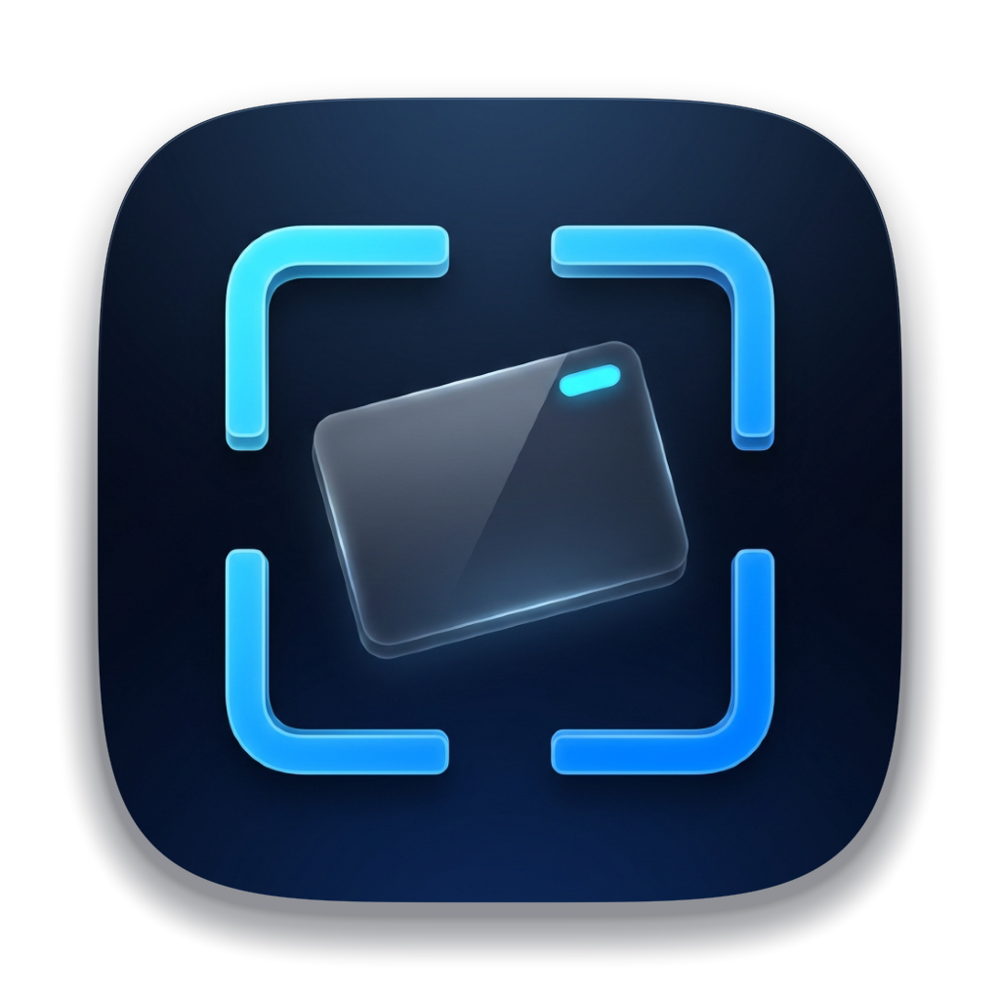

<div align="center">



# SnipGo

**专为 macOS 打造的极速、轻量、全本地离线截图与悬浮贴图工具**

[](https://github.com/Lumiaqian/snipgo/releases)
[](go.mod)
[](#项目架构)
[](.github/workflows/ci.yml)
[](https://github.com/Lumiaqian/snipgo/releases)
[](LICENSE)

0ms 透明取景 · 10 种矢量标注 · 套模板工作台 · 离线 AI 抠图与表格识图 · 滚动长截图 · 拉帘对比贴图

[下载最新版](https://github.com/Lumiaqian/snipgo/releases) · [核心功能](#-核心功能一览) · [快捷键速查](#-快捷键速查表) · [安装与首次运行](#-下载与安装) · [开发与发版](#-本地开发与自动化发版)

</div>

---

SnipGo 基于纯 Go（`CGO_ENABLED=0` + [`MyGo`](https://mygo.egoist.dev/docs) + `purego`）原生调用 macOS **ScreenCaptureKit**、**Vision**、**CoreGraphics** 与 **AppKit**。菜单栏常驻、默认全流程本地离线处理、无主窗口干扰，兼顾 **Snipaste** 的高效工作流与 **Shottr / CleanShot X** 的精致工具体验。

## ✨ 核心功能一览

### 1. 极速透明取景、开发者取色与像素标尺
- **0ms 实时透明框选（`Cmd+Shift+2`）**：按下快捷键直接弹出透明选区蒙层，选区内透出原生桌面；移动鼠标自动识别 Z 序最上层可见窗口，单击即锁定窗口，拖拽自由框选，支持多屏与异形缩放组合。
- **定格与延时定格（`Ctrl+Cmd+2` / `Ctrl+Shift+Cmd+2`）**：全屏定格（支持 3s / 5s / 10s 倒计时从容展开右键菜单与 Hover 浮层），配合 **11×11 像素放大镜**精准取色，按 **`R`** 开启十字射线像素测量尺自动吸附 UI 边缘并单击复制 `W × H px`。
- **开发者取色与多色卡**：选区内按 **`Tab`** 实时切换 `#HEX` / `rgb()` / `oklch()` / Tailwind 最近色阶；按 **`C`** 复制色值（`Shift+C` 带格式前缀），按 **`P`** 连续采集色点并按 **`Shift+P`** 一键贴出横向开发配色板。
- **纯净单窗抠图（`W`）**：锁定窗口后通过 `SCContentFilter(desktopIndependentWindow)` 直接捕获独立窗口本体，自动剔除壁纸与上方遮挡窗口。

### 2. 10 种矢量标注、局部放大镜与一键敏感脱敏
- **完备标注工具箱（`1`~`9`, `0`）**：矩形框（`1`）、真椭圆（`2`）、流线实心箭头（`3`）、均匀半透明荧光笔（`4`）、高对比步骤序号 `①②③`（`5`）、像素马赛克（`6`）、原生字体批注（`7`）、聚光灯高亮暗角（`8`）、四边插值无痕擦除（`9`）与 **局部放大镜特写气泡（`0`）**（支持原地放大、拖拽引线特写及 `2×`~`4×` 倍率切换）。
- **点选二次编辑**：在无选中工具态单击已有图元即可整体平移、拖拽控制点、换色改粗细或按 `Delete` 删除；支持多步快照 `Cmd+Z` / `Shift+Cmd+Z` 撤销重做。
- **一键敏感信息脱敏（`X`）**：离线 Vision 扫描当前选区文本，自动定位并遮盖 `sk-...` / `ghp_...` / `AKIA...` 密钥、手机号、邮箱、身份证号与内网 IP，生成可随时调整或撤销的无痕擦除块。

### 3. 套模板工作台（`B` · SnipGo Studio）
不再是单调渐变底框，而是专为日常分享与归档打造的 **10 套高颜值实用模板**（选区与悬浮贴图均按 `B` 或历史卡片图标直达）：
- **手账便签**：和纸胶带、横线信纸、标题配文与拟真折角。
- **拍立得**：相纸内凹边框、宽底留白、配文与日期印记。
- **浏览器框**：点阵展示底板、仿真 macOS 交通灯与自定义网址栏。
- **分享卡片**：标签胶囊、粗体大标题与左竖线引用批注块。
- **复古小票**：热敏纸锯齿撕边、虚线分隔与确定性条形码印记。
- **终端代码**：仿真 macOS 终端窗口顶栏、深浅多主题终端底色与状态底栏。
- **35mm胶片**：上下齿孔胶片边框、负片/暖色片帧号印记与说明文字。
- **评审工单**：UI/PR 走查清单式工单框、`BUG`/`FIX`/`REVIEW` 状态徽标与像素尺寸脚注。
- **邮戳明信片**：航空邮戳波纹、齿孔邮票装饰、明信片横格线与寄语印章。
- **幻灯分栏**：16:9 演示幻灯片左右分栏版式，左侧要点与右侧截图同框呈现。
- 全套工作台采用 **macOS 26/27 原生 Liquid Glass 液态玻璃**、**系统深/浅外观自适应配色**与**渐进式滚动边缘模糊**；每套模板内置 3~4 组纸色/画框主题、实时所见即所得预览、自定义标题配文、日期水印开关、紧凑/标准/宽幅边距，以及底部 **原生 PNG 文件拖出手柄** 与复制 / 贴图 / 保存一键导出。

### 4. 离线 AI 主体抠图与结构化表格识图
- **离线 AI 一键抠图（`K`）**：调用 macOS 14+ 原生 `VNGenerateForegroundInstanceMaskRequest` 全景实例分割，毫秒级离线剥离背景生成透明 PNG，并自动作为无边框异形贴纸悬浮桌面（选区与悬浮贴图均支持）。
- **极速离线识图与表格还原（`O` / `Alt+Cmd+O`）**：自动识别中英混排段落与二维码（支持直达打开 URL 链接）；检测到 2×2 及以上表格结构时，自动解锁 **「纯文本 / Markdown 表格 / Excel & 飞书 TSV」** 一键切换复制。

### 5. 滚动长截图（`L`）
- 锁定框选区域后按下 `L`，弹出穿透式绿色取景框，可自由滚轮浏览网页、长文档或聊天记录；后台自动剥离固定吸顶/吸底栏与右侧滚动条，按高方差纹理带精准对齐并执行接缝羽化融合，右侧实时预览拼接进度。

### 6. 悬浮贴图全家桶、拉帘对比与高效管理
- **万物皆可贴（`Alt+Cmd+2`）**：剪贴板图片、本地图片文件、多行文本/代码片段（渲染为高分屏便签卡）、颜色文本（生成带 HEX/RGB/OKLCH/Tailwind 信息卡）一键钉上桌面。
- **拉帘对比 & 像素 Diff 热力图（`D`）**：桌面存在 2 张以上贴图时按 `D` 进入 Before/After 左右拉帘对比与逐像素差异热力图（`Tab` 切换模式、`Cmd+C` 一键复制对比成图）。
- **贴图交互与拖拽**：贴图支持原地进入矢量标注（`E`）、滚轮缩放、`Shift`/`Alt+滚轮` 调透明度、右键 8px 边缘磁吸与横纵向拼接、点击穿透（`P`）、折叠为迷你胶囊（`M`），以及按住悬停栏左一按钮直接将 `.png` 拖入微信、Slack、GitHub 或 Finder。
- **最近截图历史（`Cmd+Shift+H`）& 免弹窗快存**：自动环形归档最近 20 张截图（双列网格预览、直接拖出 PNG、复制/贴图/套模板/识图/删除）；偏好设置（`Cmd+,`）支持点击键帽直接按键录入并校验冲突的全部全局快捷键、`Cmd+S` 免弹窗一键快存与保存同时复制到剪贴板。
- **macOS 26 Tahoe Liquid Glass 体验与物理弹簧动效**：原生 `NSGlassEffectView` 融合着色与 `glass.NewGroup` 合并玻璃按钮组、滑动液态玻璃分段控制器、物理拉伸旋钮开关、渐进式滚动边缘模糊与弹簧入场动画；偏好设置支持实时切换 **外观模式（跟随系统 / 浅色 / 深色）**、**液态玻璃浓度（清透 / 标准 / 浓磨砂）** 与 **8 种系统/自定义主题强调色**；全浮窗统一左上角带清晰 `×` 的 macOS 红灯关闭按钮（`Cmd+W` / `Esc` 关闭，菜单栏常驻，`Cmd+Q` 退出应用）。
- **内置签名自动更新**：底层接入 MyGo 官方 `mygo.Updater`（直接从 GitHub Releases 静态下载通道读取 `update-darwin-*.json`，不受 GitHub REST API 限流 403 影响），配合 Liquid Glass 更新窗支持后台每 24 小时静默检测、Beta 预览版通道、跳过指定版本与更新日志展示；下载归档与 `bsdiff` 增量补丁经 **Ed25519 公钥数字签名校验**，退出时原子替换 `.app` 包并平滑重启（保留全部配置与历史记录；未使用 Developer ID 签名的 ad-hoc 构建在更新后签名哈希会变化，macOS 会要求重新授予屏幕录制权限）。

---

## ⌨️ 快捷键速查表

<details open>
<summary><strong>点击展开 / 收起全部快捷键对照</strong></summary>

### 全局快捷键（可在「偏好设置 <code>Cmd+,</code>」自定义）
| 快捷键 | 功能 |
|---|---|
| `Cmd+Shift+2` | 区域截图（实时透明框选） |
| `Ctrl+Cmd+2` | 定格屏幕截图与像素标尺 |
| `Ctrl+Shift+Cmd+2` | 延时定格截图（3s / 5s / 10s） |
| `Alt+Cmd+O` | 一步框选识图（OCR / 表格 / 二维码） |
| `Alt+Cmd+2` | 从剪贴板万物贴图 |
| `Cmd+Shift+H` | 打开 / 收起最近截图历史抽屉 |
| `Shift+Alt+Cmd+2` | 恢复刚关闭的悬浮贴图（最多 12 张） |
| `Ctrl+Alt+Cmd+2` | 恢复所有鼠标穿透贴图的交互 |

### 选区与标注阶段
| 按键 / 手势 | 功能 |
|---|---|
| `1`~`9`, `0` | 切换标注工具：`1` 矩形 `2` 椭圆 `3` 箭头 `4` 荧光笔 `5` 序号 `6` 马赛克 `7` 文字 `8` 聚光灯 `9` 擦除 `0` 放大镜 |
| `X` / `K` / `W` | `X` 敏感脱敏 / `K` AI 主体抠图 / `W` 纯净单窗 |
| `B` / `L` / `O` | `B` 套模板工作台 / `L` 滚动长截图 / `O` 识图提字 |
| `Enter` / `Cmd+C` / 双击选区 | 复制到剪贴板并完成 |
| `T` / `Cmd+T` / `Cmd+S` | `T` 悬浮贴图 / `Cmd+S` 保存为 PNG |
| `Tab` / `C` / `P` / `Shift+P` | 切换取色格式 / 复制色值 / 采色进色板 / 贴出多色卡 |
| `R` / `Space` | 定格下开关像素测量尺 / 框选时切换窗口识别 |
| `方向键` / `Alt+方向键` | 1 DIP 平移选区或调整尺寸（加 `Shift` 步进 10 DIP） |
| `Cmd+Z` / `Shift+Cmd+Z` / `Delete` | 撤销 / 重做 / 删除当前选中的标注图元 |

### 悬浮贴图 & 套模板工作台
| 场景 | 按键 / 手势 | 功能 |
|---|---|---|
| 悬浮贴图 | `E` / `K` / `B` / `D` | 原地标注 / AI 主体抠图 / 套模板 / 双图拉帘与 Diff 对比 |
| 悬浮贴图 | `O` / `P` / `M` / `R` | 识图 / 鼠标穿透 / 折叠胶囊 / 像素标尺 |
| 悬浮贴图 | 滚轮 / `Shift+滚轮` / 双击 | 缩放大小 / 调节透明度 / 双击关闭 |
| 套模板工作台 | `Enter` / `Cmd+C` / `T` / `Cmd+S` | 复制成图 / 转为悬浮贴图 / 保存 PNG（文本输入框失焦时生效） |
| 全部浮窗 | 左上角红灯 / `Cmd+W` / `Esc` / `Cmd+Q` | 关闭当前浮窗（应用继续菜单栏常驻）/ `Cmd+Q` 彻底退出 SnipGo |

</details>

---

## 📦 下载与安装

1. 前往 [GitHub Releases](https://github.com/Lumiaqian/snipgo/releases) 下载对应架构的最新包：
   - **Apple Silicon（M1–M5）**：`SnipGo-*-AppleSilicon-arm64.dmg`
   - **Intel Mac**：`SnipGo-*-Intel-amd64.dmg`
   - **通用包**：`SnipGo-*-Universal.dmg`
2. 拖入 `/Applications`（应用程序）文件夹。
3. **首次启动与权限说明（需要 macOS 14.0+）**：
   - 未签名版本若触发 macOS“已损坏/无法验证开发者”提示，在终端执行一次移除隔离属性即可正常打开：
     ```sh
     xattr -dr com.apple.quarantine /Applications/SnipGo.app
     ```
   - 首次截屏请在 **系统设置 → 隐私与安全性 → 录屏与系统录音** 中允许 **SnipGo**，授权后重开应用生效。
   - ad-hoc 签名构建（未配置 Developer ID 证书的发布包）的屏幕录制授权绑定在具体的二进制哈希上：每次更新或重新编译后，macOS 都可能视其为新应用。若截图提示需要权限，请在上述设置中重新打开 SnipGo 的开关（必要时先删除旧记录），再重启应用。

---

## 🏗 项目架构

全部核心逻辑以纯 Go 编写（零 CGO 依赖），通过 `purego` 桥接 macOS 系统框架：

| 模块 / 文件 | 职责 |
|---|---|
| `main.go` / `theme.go` / `icons.go` | 应用生命周期、菜单栏常驻与 `@2x` 模板托盘图标、全局快捷键、macOS 26/27 原生 Liquid Glass 液态玻璃、深/浅外观自适应配色、渐进式滚动边缘模糊与矢量 SVG 图标集 |
| `overlay.go` / `template_ui.go` | 多屏透明选区蒙层、实时窗口高亮、双层浮空胶囊工具栏、像素放大镜 / 测量尺，以及所见即所得 10 模板「套模板工作台」 |
| `pin.go` / `scroll_ui.go` / `ocr.go` / `history.go` / `settings.go` / `updater_ui.go` | 悬浮贴图窗口、滚动长图穿透控制盒、表格识图面板、最近 20 张截图历史抽屉、偏好设置（含外观/玻璃/主题色与快捷键录制）、延时倒计时胶囊，以及基于 `mygo.Updater` Ed25519 签名更新内核的 Liquid Glass 软件更新窗 |
| `window_darwin.go` / `window_other.go` | `NSWindow` / `NSPanel` 窗口层级（`kCGStatusWindowLevel+2`）、原生 `NSAppearance` 切换、全屏 Space 兼容与非 macOS 占位实现 |
| [`internal/session`](internal/session) | 截图核心状态机（`Idle → Capturing → Selecting → Adjusting`）、窗口命中、图元点选二次编辑与动作编排 |
| [`internal/annotate`](internal/annotate) | 10 种矢量与像素标注图元、命中选中与端点编辑、多步撤销/重做栈以及 Retina 抗锯齿栅格化渲染 |
| [`internal/beautify`](internal/beautify) | 10 套实用模板引擎（`RenderTemplate`）、`HEX / RGB / OKLCH / Tailwind` 色值转换、多色卡与代码便签卡合成 |
| [`internal/vision`](internal/vision) | macOS `Vision.framework` 离线中英混排 OCR、二维表格重建（Markdown / TSV）、主体前景抠图、敏感凭证检测与二维码解析 |
| [`internal/pinops`](internal/pinops) | 贴图逐像素 Diff 热力图、Before/After 拉帘合成、8px 边缘磁吸对齐与多贴图横纵向拼接 |
| [`internal/scrollcap`](internal/scrollcap) | 滚动长截图增量拼接引擎：固定头尾栏与右侧滚动条剥离、纹理带匹配与接缝羽化融合 |
| [`internal/capture`](internal/capture) | ScreenCaptureKit 屏幕/独立单窗采集与 CoreGraphics Z 序遮挡感知窗口探测 |
| [`internal/crop`](internal/crop) | DIP 选区坐标映射与跨屏多缩放最近邻像素拼接裁剪 |
| [`internal/measure`](internal/measure) | 四向颜色差分边缘吸附像素测量尺 |
| [`internal/textrender`](internal/textrender) | CoreGraphics + `NSFont` 高分屏中英文与等宽代码离线光栅化 |
| [`internal/store`](internal/store) & [`internal/config`](internal/config) | 本地截图历史环形仓库与用户偏好设置持久化 |

---

## 🛠 本地开发与自动化发版

### 本地常用命令
```sh
# 1. 开发构建与热重载
go tool mygo dev

# 2. 运行全部单元测试（零 CGO）
CGO_ENABLED=0 go test -count=1 ./...

# 3. 并发竞态检测 & UI 生命周期静态检查
go test -race -count=1 ./...
go tool mygo vet .
GOOS=linux CGO_ENABLED=0 go vet ./...

# 4. 生成最近渲染走查截图拼图（可选）
SNIPGO_PREVIEW_DIR=/tmp/snipgo-preview CGO_ENABLED=0 go test -count=1 .

# 5. 打包 .app（与 .dmg）
go tool mygo build -skip-dmg
```

> 真实屏幕采集自测：`SNIPGO_CAPTURE=1 go test -run TestGrabRealDisplays ./internal/capture/`（需授予终端屏幕录制权限）。

### GitHub Actions 流水线
- **持续集成（`.github/workflows/ci.yml`）**：推送 `main`、发起 PR 或手动触发时自动运行完整测试、`mygo vet`、跨平台检查并打包 `arm64` / `amd64` / `universal` 构建产物。
- **自动发版（`.github/workflows/release.yml`）**：推送 `v*` 标签（如 `git tag v0.2.0 && git push origin v0.2.0`）自动构建三架构 `.dmg`（`AppleSilicon-arm64` / `Intel-amd64` / `Universal`），并在配置 `MYGO_UPDATER_PRIVATE_KEY` 机密时一并生成带 Ed25519 签名的 `update-darwin-*.json`、`.tar.gz`、`.delta` 增量更新与 `SHA256SUMS.txt` 发布 Release。未配置证书机密时自动使用 ad-hoc 签名；配置 `MACOS_CERTIFICATE`、`MACOS_CERTIFICATE_PASSWORD`、`MACOS_SIGNING_IDENTITY`（及公证所需的 `APPLE_ID`、`APPLE_TEAM_ID`、`APPLE_APP_PASSWORD`）即可全自动完成正式签名与 Apple 公证。

---

## 📄 开源协议

本项目基于 [MIT License](LICENSE) 开源。
