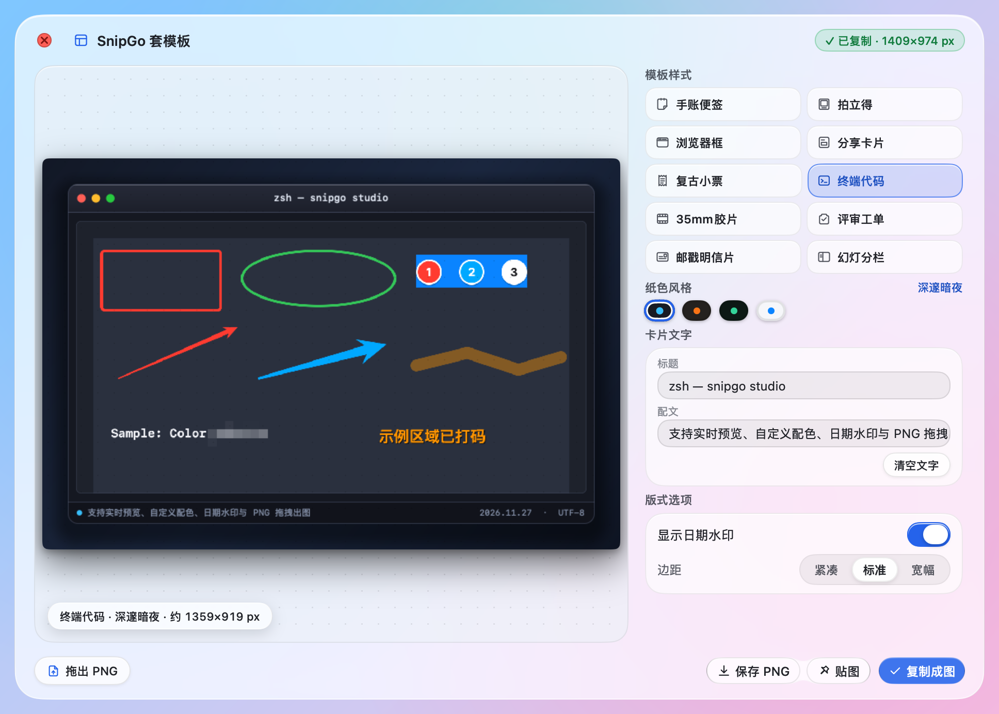
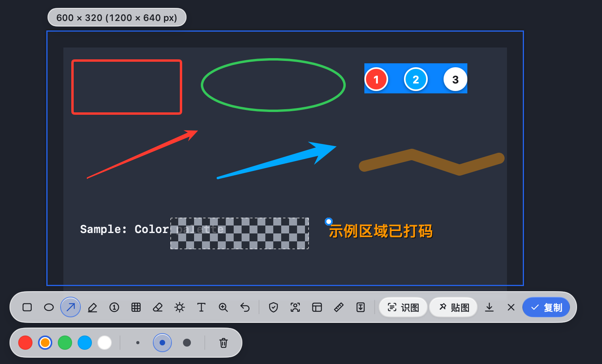

<div align="center">


# SnipGo

**专为 macOS 打造的极速、轻量、全本地离线截图、选区录屏、悬浮贴图与 Agent CLI 工具**

[](#-下载与安装)
[](go.mod)
[](#-项目架构)
[](.github/workflows/ci.yml)
[](https://github.com/Lumiaqian/snipgo/releases)
[](LICENSE)

[](https://awesomemygo.dev/apps/snipgo)

0ms 透明取景 · 10 种矢量标注 · 套模板工作台 · 选区录屏与零 FFmpeg GIF · 离线 AI 抠图与表格识图 · 命令行 CLI 与 Agent Skill

[下载最新版](https://github.com/Lumiaqian/snipgo/releases) · [核心功能](#-核心功能一览) · [CLI 与 Agent](#-命令行与-ai-agent-集成) · [快捷键速查](#-快捷键速查表) · [下载与安装](#-下载与安装) · [项目架构](#-项目架构) · [开发与发版](#-本地开发与自动化发版)

</div>

---

SnipGo 主程序基于纯 Go（`CGO_ENABLED=0` + [`MyGo`](https://mygo.egoist.dev/docs) + [`mygo-ui-sdk`](https://github.com/Lumiaqian/mygo-ui-sdk) + `purego`）原生调用 macOS **ScreenCaptureKit**、**Vision**、**CoreGraphics** 与 **AppKit**，并通过随包内置的独立 Swift 助手 `SnipGoVideo` 完成选区与单窗视频采集。菜单栏常驻、全流程本地离线处理、无主窗口干扰，兼顾 **Snipaste** 的高效工作流与 **Shottr / CleanShot X** 的精致体验，同时提供面向脚本与 AI Coding Agent 的统一命令行接口（`snipgo --json`）与内置 `Agent Skill`。

<p align="center">
  
  <br />
  <sub><strong>SnipGo Studio 套模板工作台</strong> · macOS Liquid Glass 原生界面，10 套实用模板所见即所得预览与 PNG 拖拽出图</sub>
</p>

---

## ✨ 核心功能一览

### 1. 极速透明取景、弹出菜单截图、开发者取色与像素标尺
- **0ms 实时透明框选（`Cmd+Shift+2`）**：按下快捷键直接弹出透明选区蒙层，选区内透出原生桌面；拖拽拉出自定义选区、轻点识别并锁定 Z 序最上层可见窗口，按 `Space` 可切换悬停窗口高亮，支持多屏与异形缩放组合。
- **展开菜单直接框选**：打开下拉菜单或右键菜单后直接唤起框选截图时，自动定格可捕获的弹出菜单画面，且选区在非文字编辑状态下保持在菜单上方，避免切焦点导致菜单消失。
- **定格与延时定格（`Ctrl+Cmd+2` / `Ctrl+Shift+Cmd+2`）**：全屏定格，支持 3s / 5s / 10s 倒计时从容展开复杂浮层（倒计时中可按 `Enter` / `Space` 或点「立即」抢跑定格）；配合 **11×11 像素放大镜**精准取色，未选区时按 `R` 开启十字射线测量尺自动吸附 UI 边缘并单击复制 `W × H px`（实时态按 `R` 也会切入冻结测量尺）。
- **开发者取色与交互多色卡（`Ctrl+Cmd+C`）**：
  - 独立冻结取色器支持左键/`C` 复制、`Shift+左键`/`P` 连续采色进色板；普通框选态按 `Tab` 可无缝切入冻结取色并保留已采色点。
  - 再按 `Tab` 循环切换 `#HEX` / `rgb()` / `oklch()` / Tailwind 完整 244 色官方色阶（非精确命中标 `≈`）；`C` 复制完整格式、`Shift+C` 复制纯色值并弹毛玻璃轻提示。
  - 顶部多色板条自动跟随屏幕，支持单击复制、右键删点、`Delete` 撤尾色、WCAG 2.1 对比度评级、一键复制 `:root` CSS 变量，以及 `Shift+P` 贴出可点击复制与按 `Tab` 切格式的交互色卡。
- **纯净单窗抠图（`W`）**：锁定窗口后通过 `SCContentFilter(desktopIndependentWindow)` 直接捕获独立窗口本体，自动剔除壁纸与上方遮挡窗口。

### 2. 10 种矢量标注、局部放大镜与一键敏感脱敏
- **完备标注工具箱（`1`~`9`, `0`）**：矩形框（`1`）、真椭圆（`2`）、流线实心箭头（`3`）、均匀半透明荧光笔（`4`）、高对比步骤序号 `①②③`（`5`）、像素马赛克（`6`）、原生字体批注（`7`）、聚光灯高亮暗角（`8`）、四边插值无痕擦除（`9`）与 **局部放大镜特写气泡（`0`）**（原地放大、拖拽引线特写及 `2×`~`4×` 倍率切换）。
- **点选二次编辑与文字重编**：无选中工具态单击已有图元可整体平移、拖拽控制点、换色改粗细或 `Delete` 删除；**双击已有文字批注可原地预填重编**（清空回车即带撤销删除），支持多步快照 `Cmd+Z` / `Shift+Cmd+Z` 撤销重做。
- **一键敏感信息脱敏（`X`）**：离线 Vision 扫描当前选区文本，自动定位并遮盖 `sk-...` / `ghp_...` / `AKIA...` 密钥、手机号、邮箱、身份证号与内网 IP，生成可微调或撤销的无痕擦除块。

<p align="center">
  
  <br />
  <sub><strong>选区与双层悬浮标注工具栏</strong> · 实时尺寸徽标、矢量图元二次编辑与智能打码</sub>
</p>

### 3. 套模板工作台（`B` · SnipGo Studio）
选区、悬浮贴图或历史卡片均可一键直达，内置 **10 套实用分享与归档模板**（每套含 3~4 组纸色/画框风格）：

| 模板 | 视觉与版式特点 | 模板 | 视觉与版式特点 |
|---|---|---|---|
| **手账便签** | 和纸胶带、横线信纸、标题配文与拟真折角 | **终端代码** | 仿真 macOS 终端顶栏、深浅多主题底色与状态底栏 |
| **拍立得** | 相纸内凹边框、宽底留白、配文与日期印记 | **35mm胶片** | 上下齿孔胶片边框、负片/暖色片帧号与说明文字 |
| **浏览器框** | 点阵展示底板、macOS 交通灯与自定义网址栏 | **评审工单** | UI/PR 走查清单框、`BUG`/`FIX`/`REVIEW` 徽标与尺寸脚注 |
| **分享卡片** | 标签胶囊、粗体大标题与左竖线引用批注块 | **邮戳明信片** | 航空邮戳波纹、齿孔邮票装饰、横格线与寄语印章 |
| **复古小票** | 热敏纸锯齿撕边、虚线分隔与确定性条形码 | **幻灯分栏** | 16:9 演示幻灯片左右分栏，要点与截图同框呈现 |

- 工作台采用 **macOS 26/27 原生 Liquid Glass 液态玻璃** 与深/浅外观自适应配色，支持标题配文、日期水印、紧凑/标准/宽幅边距调节，所有偏好**自动持久化跨重启记忆**；底部提供 **原生 PNG 文件拖出手柄** 与复制 / 贴图 / 保存（`⌘S` 快存 / `⇧⌘S` 另存为）一键导出。

### 4. 选区短录屏、裁切工作室与零 FFmpeg 导出 GIF（`R`）
- **现有选区一键开录（`R`）**：框选同一屏幕上的区域后按 `R` 或点击工具栏录屏按钮即可开始录制（定格选区会自动切回实时画面）。默认开启 3 秒倒计时，支持按 `Enter` / `Space` 或点「立即开始」抢跑、按 `Esc` 取消，也可在偏好设置中关闭倒计时直录。
- **单行 Liquid Glass 录制控制条**：默认静音，状态栏同步显示 `🔴` 提示；悬浮控制条支持暂停/继续（聚焦 `Space`）、独立开关系统音（`A`）与麦克风（`M`，仅显式开启时才检查并按需请求麦克风权限）、二次确认丢弃（`Esc`）与停止（`Enter`）。
- **录后预览与裁切工作室**：停止后可直接拖出未裁切的原始 MP4，或在工作室内循环播放并用双滑块精准裁切首尾。支持导出 **MP4**（原始 / 1080p，含音轨时可选「静音导出」）或 **零 FFmpeg 原生 2-Pass GIF**（宽度 `640` / `960` / `1280 px`，帧率 `10` / `15` / `24` / `30 fps`，超过 10 MB 自动提示调参），带实时导出进度与取消、原生文件拖出及复制（`⌘C`）/ 保存（`⌘S` / `⇧⌘S`）。

### 5. 离线 AI 主体抠图与结构化表格识图
- **离线 AI 一键抠图（`K`）**：调用 macOS 14+ 原生 `VNGenerateForegroundInstanceMaskRequest` 全景实例分割，毫秒级离线剥离背景生成透明 PNG，并自动作为无边框异形贴纸悬浮桌面（选区与贴图均支持）。
- **离线识图与表格还原（`O` / `Alt+Cmd+O`）**：识别中英混排段落与二维码（多条链接支持展开/收起并直达打开）；`Cmd+C` 一键复制当前视图；检测到 2×2 及以上表格时，支持按钮或 `Tab` 轮切 **「纯文本 / Markdown 表格 / Excel & 飞书 TSV」**。

### 6. 滚动长截图（`L`）
- 框选区域后按 `L` 弹出穿透式绿色取景框，可自由滚轮浏览网页、长文档或聊天记录；后台自动剥离固定吸顶/吸底栏与右侧滚动条，按高方差纹理带精准对齐并执行接缝羽化融合，右侧实时预览拼接进度；支持 `Space` 暂停/继续拼接、`T` 贴图、`Cmd+S` / `⇧⌘S` 保存与 `Enter` 完成复制。

### 7. 悬浮贴图全家桶、拉帘对比与系统体验
- **万物皆可贴（`Alt+Cmd+2`）**：剪贴板图片、本地图片文件、多行文本/代码片段（高分屏便签卡）与颜色文本（交互式多格式色卡）一键钉上桌面。
- **拉帘对比 & 像素 Diff 热力图（`D`）**：桌面存在 2 张以上贴图时按 `D` 进入 Before/After 左右拉帘对比与逐像素差异热力图（`Tab` 切模式、`Cmd+C` 复制成图）。
- **贴图全功能交互**：支持原地矢量标注（`E` 完整对齐选区工具箱与双击改字）、滚轮/`Cmd+0`/`+`/`-` 缩放、`Shift`/`Alt+滚轮` 调透明度、右键 8px 边缘磁吸与横纵向拼接、点击穿透（`P`）、折叠迷你胶囊（`M`），以及按住悬停栏左一按钮直接将 `.png` 拖入微信、Slack、GitHub 或 Finder。
- **截图历史（`Cmd+Shift+H`）与偏好设置（`Cmd+,`）**：环形归档最近 20 张截图（支持拖出 PNG、数字键 `1`~`9` 快捷复制与一键保存/贴图/套模板/识图）；偏好设置分为「外观与主题 / 全局快捷键 / 通用与更新 / 命令行与 Agent」四分页，支持按键录制与冲突校验、`Cmd+S` 免弹窗快存、录屏前 3 秒倒计时开关、外观模式（跟随系统 / 浅色 / 深色）、液态玻璃浓度（清透 / 标准 / 浓磨砂）与 8 种主题强调色。
- **Ed25519 签名自动更新**：接入 `mygo.Updater` 静态读取 GitHub Releases 的 `update-darwin-*.json`（不受 REST API 限流影响），每 24 小时后台检测，支持 Beta 通道与 `bsdiff` 增量补丁；归档经 Ed25519 公钥校验后原子替换并平滑重启。

---

## 🤖 命令行与 AI Agent 集成

SnipGo 内置统一命令行工具 `snipgo` 与 Agent Skill（[`skills/snipgo/SKILL.md`](skills/snipgo/SKILL.md)），让脚本、CI 与 Claude Code / Codex 等 AI Coding Agent 可直接复用 SnipGo 的全部离线视觉与桌面能力。

### 安装 CLI 与 Agent Skill
1. **安装命令行工具**：打开 SnipGo **偏好设置（`Cmd+,`）→ 命令行与 Agent**，点击 **「安装命令行工具」**，将在 `~/.local/bin/snipgo` 创建指向当前 `SnipGo.app` 主程序的软链（若 `~/.local/bin` 尚未加入 `PATH`，设置页会给出提示）。
2. **安装 Agent Skill（可选）**：
   ```sh
   npx skills add Lumiaqian/snipgo
   ```

### 分层命令能力（统一 `--json` 输出）

所有子命令均支持 `--json`，将标准 JSON 对象输出到 `stdout`、诊断信息输出到 `stderr`：

- **Tier 1 · 本地文件处理（无需运行菜单栏宿主，不依赖桌面授权）**：
  ```sh
  # 检查 CLI 状态与宿主权限（先看 data.tier1_ready / data.tier2_ready）
  snipgo status --json

  # 离线 OCR 识图与表格提取（text / markdown / tsv）
  snipgo ocr input.png --format markdown --json

  # 自动敏感信息脱敏（erase / mosaic；分享前请人工复核）
  snipgo redact input.png --style erase --out safe.png --json

  # 离线 AI 主体抠图（--trim-pad >= 0 时自动裁去透明留白）
  snipgo cutout input.png --trim-pad 0 --out subject.png --json

  # 查看全部模板键与主题名，并套用截图模板
  snipgo template --list --json
  snipgo template input.png --kind browser --theme 0 --out card.png --json

  # 像素差异对比与 CI 回归门禁（heatmap / split）
  snipgo diff before.png after.png --mode heatmap --max-diff-percent 0.1 --out diff.png --json

  # 本地 MP4 裁切转零 FFmpeg 2-Pass GIF
  snipgo gif clip.mp4 --start 0 --end 4.5 --width 960 --fps 15 --out clip.gif --json
  ```

- **Tier 2 · 本机桌面与历史访问（默认关闭，需手动授权）**：
  在 **偏好设置 → 命令行与 Agent** 手动开启 **「允许本机命令行与 Agent 访问桌面与历史」** 后，运行中的 SnipGo 宿主会在仅当前用户可访问（`0700`）的目录中监听本地 Unix Socket（`agent.sock`），并对连接进程执行同账户身份校验、客户端断开自动取消与前端可见提示：
  ```sh
  # 枚举可见窗口并按应用名过滤
  snipgo windows --app Safari --json

  # 读取最近截图历史（可附带 --redact-out DIR 生成脱敏副本）
  snipgo history --latest --json

  # 抓取指定窗口 / 区域 / 显示器，并可选串联脱敏与识图
  snipgo capture --window 1234 --redact --ocr --out capture.png --json

  # 录制单窗或区域短片（1~60 秒，支持 .mp4 / .gif，默认静音）
  snipgo record --window 1234 --duration 3 --width 960 --fps 15 --out demo.gif --json

  # 将图片、文本或色值直接贴上桌面
  snipgo pin image.png --json
  snipgo pin --text "Review complete" --json
  snipgo pin --color "#123456" --json
  ```

> [!NOTE]
> **Agent 录屏音频与安全边界**：
> - `snipgo record` 时长必填且上限 60 秒，默认静音，客户端断开会自动停止并清理；Agent 通道不允许开启麦克风。
> - `--rect` 配合 `--system-audio` 录制系统音频；`--window` 配合 `--system-audio` 仅请求目标应用音频（可能包含同一应用的其他窗口/标签页），若无法确认隔离范围（含 macOS 15.2 之前版本）会在开录前直接返回错误，绝不静默回退全系统音频。GIF 无音轨，如需声音请输出 `.mp4`（详见 `snipgo help record`）。

### 退出码约定
| 退出码 | 错误码示例 | 含义 |
|---|---|---|
| `0` | — | 执行成功 |
| `2` | `INVALID_ARGS` | 参数或输入路径不合法 |
| `3` | `PERMISSION_DENIED` / `AGENT_IPC_DISABLED` | 缺少屏幕录制权限或未开启本机桌面访问 |
| `4` | `HOST_NOT_RUNNING` | 需要桌面宿主但 SnipGo 未运行 |
| `5` | `NOT_FOUND` | 目标窗口、显示器或记录不存在 |
| `6` | `PROCESS_FAILED` | 处理失败或 `diff` 超出 `--max-diff-percent` 阈值 |
| `130` | `CANCELED` | 请求已取消或连接断开 |

---

## ⌨️ 快捷键速查表

<details open>
<summary><strong>点击展开 / 收起全部快捷键对照</strong></summary>

### 全局快捷键（可在「偏好设置 <code>Cmd+,</code>」自定义）
| 快捷键 | 功能 |
|---|---|
| `Cmd+Shift+2` | 区域截图（实时透明框选） |
| `Ctrl+Cmd+2` | 定格屏幕截图与像素标尺 |
| `Ctrl+Cmd+C` | 独立屏幕取色器（取色与多色卡） |
| `Ctrl+Shift+Cmd+2` | 延时定格截图（3s / 5s / 10s） |
| `Alt+Cmd+O` | 一步框选识图（OCR / 表格 / 二维码） |
| `Alt+Cmd+2` | 从剪贴板万物贴图 |
| `Cmd+Shift+H` | 打开 / 收起最近截图历史抽屉 |
| `Shift+Alt+Cmd+2` | 恢复刚关闭的悬浮贴图（最多 12 张） |
| `Ctrl+Alt+Cmd+2` | 恢复所有鼠标穿透贴图的交互 |

### 选区与标注阶段
| 按键 / 手势 | 功能 |
|---|---|
| `1`~`9`, `0` | 切换标注工具：`1` 矩形 `2` 椭圆 `3` 箭头 `4` 荧光笔 `5` 序号 `6` 马赛克 `7` 文字 `8` 聚光灯 `9` 擦除 `0` 放大镜 |
| `X` / `K` / `W` | `X` 敏感脱敏 / `K` AI 主体抠图 / `W` 纯净单窗 |
| `B` / `L` / `O` | `B` 套模板工作台 / `L` 滚动长截图 / `O` 识图提字 |
| `Enter` / `Cmd+C` / 双击选区 | 复制到剪贴板并完成 |
| `T` / `Cmd+T` / `Cmd+S` / `⇧⌘S` | `T` 悬浮贴图 / `Cmd+S` 快存 PNG / `⇧⌘S` 另存为 |
| `Tab` / `C` / `Shift+C` | 实时态切冻结取色或循环切格式 / 复制完整色值 / 复制去前缀纯色值 |
| `P` / `Shift+P` / `Delete` | 采色进色板 / 贴出交互多色卡 / 删选中标注或退色板末色 |
| `R` / `Space` | 未选区时开关像素标尺，已有选区时进入 3 秒录屏倒计时（`Enter` / `Space` 或「立即开始」抢跑，`Esc` 取消；偏好设置可关闭倒计时直录） / 框选时切换窗口识别 |
| `方向键` / `Alt+方向键` | 1 DIP 平移选区或调整尺寸（加 `Shift` 步进 10 DIP） |
| `Cmd+Z` / `Shift+Cmd+Z` / `Delete` | 撤销 / 重做 / 删除当前选中的标注图元 |

### 悬浮贴图、录屏与辅助面板
| 场景 | 按键 / 手势 | 功能 |
|---|---|---|
| 悬浮贴图 | `E` / `K` / `B` / `D` | 原地标注（支持 `1`~`9`, `0` 切换全部工具与样式）/ AI 主体抠图 / 套模板 / 双图拉帘与 Diff 对比 |
| 悬浮贴图 | `O` / `P` / `M` / `R` | 识图 / 鼠标穿透 / 折叠胶囊 / 像素标尺 |
| 色板与色卡贴图 | 点击色块或色行 / `Tab` / 右键 | 直接复制对应色值 / 切换贴图复制格式 / 复制 `:root` CSS 变量 |
| 悬浮贴图 | 滚轮 / `Cmd+0` / `Cmd++` / `Cmd+-` / `Shift+滚轮` / 双击 | 缩放与重置 100% / 调节透明度 / 双击关闭（非文字双击时） |
| 录屏倒计时 | `Enter` / `Space` / `Esc` | 立即开始录屏 / 取消录屏倒计时 |
| 录屏控制条（聚焦时） | `Space` / `A` / `M` / `Esc` / `Enter` | 暂停或继续 / 切换系统音 / 切换麦克风 / 二次确认丢弃 / 停止并进入录后工作室 |
| 录后工作室 | `Enter` / `Cmd+C` / `Cmd+S` / `⇧⌘S` | 立即生成 MP4 或 GIF / 复制文件 / 快存 / 另存为 |
| 滚动长截图 | `Space` / `T` / `Cmd+S` / `⇧⌘S` / `Enter` | 暂停或继续拼接 / 转为贴图 / 快存 / 另存为 / 完成复制 |
| 识图 & 历史 & 倒计时 | 识图 `Tab`·`Cmd+C` / 历史 `1`~`9` / 延时倒计时 `Enter`·`Space` | 切换识图格式·复制当前视图 / 快拷第 1~9 条历史 / 立即定格屏幕 |
| 套模板工作台 | `Enter` / `Cmd+C` / `T` / `Cmd+S` / `⇧⌘S` | 复制成图 / 转为悬浮贴图 / 快存 PNG / 另存为（文本输入框失焦时生效） |
| 全部浮窗 | 左上角红灯 / `Cmd+W` / `Esc` / `Cmd+Q` | 关闭当前浮窗（应用继续菜单栏常驻）/ `Cmd+Q` 彻底退出 SnipGo |

</details>

---

## 📦 下载与安装

1. 前往 [GitHub Releases](https://github.com/Lumiaqian/snipgo/releases) 下载对应架构的最新包：
   - **Apple Silicon**：`SnipGo-*-AppleSilicon-arm64.dmg`
   - **Intel Mac**：`SnipGo-*-Intel-amd64.dmg`
   - **通用包**：`SnipGo-*-Universal.dmg`
2. 打开下载的 DMG，将 `SnipGo.app` 拖入 `/Applications`（应用程序）文件夹。
3. 首次截屏或录屏时，在 **系统设置 → 隐私与安全性 → 录屏与系统录音** 中允许 **SnipGo**，然后退出并重新打开应用。
4. **麦克风权限（可选）**：录屏默认静音；仅当你在录制控制条中手动点击麦克风按钮时，macOS 才会按需请求麦克风权限。

> [!NOTE]
> **首次启动与签名升级说明（需要 macOS 14.0+）**
> - 官方发布包使用固定的 SnipGo 自签名证书签名（未经 Apple 公证）。首次打开若 macOS 提示“无法验证开发者”，请确认安装包来自本项目 Releases，在 **系统设置 → 隐私与安全性** 点击 **「仍要打开」**，或在终端执行一次 `xattr -cr /Applications/SnipGo.app`。
> - 从 `0.1.7` 起正式版固定使用同一发布证书，后续升级可保留屏幕录制授权。若从采用 ad-hoc 签名的 `0.1.6` 及更早版本升级后仍提示权限不足，可在 SnipGo 提示中点击 **「重置旧记录并重新授权」**，重新授权并重启即可。

---

## 🏗 项目架构

主程序全部核心逻辑以纯 Go（零 CGO）编写，通过 `purego` 桥接 macOS 系统框架；选区与窗口视频录制由随 `.app` 打包的独立 Swift 助手 `SnipGoVideo` 承担：

| 模块 / 文件 | 职责 |
|---|---|
| [`main.go`](main.go) / [`theme.go`](theme.go) / [`icons.go`](icons.go) | 应用生命周期、CLI / GUI 入口分发、菜单栏常驻与 `@2x` 模板托盘图标、全局快捷键、macOS 26/27 原生 Liquid Glass 与矢量 SVG 图标集 |
| [`overlay.go`](overlay.go) / `overlay_*.go` | 多屏选区、弹出菜单定格与层级保持、窗口高亮与像素标尺；绘制、工具栏、按键与脱敏分别位于 [paint](overlay_paint.go)、[toolbar](overlay_toolbar.go)、[keys](overlay_keys.go)、[redact](overlay_redact.go) |
| [`record_ui.go`](record_ui.go) / [`record_studio.go`](record_studio.go) / [`record_export.go`](record_export.go) | 录屏倒计时、单行 Liquid Glass 录制控制条、录后预览与裁切工作室、MP4/GIF 导出调度与文件拖出 |
| [`agent_host.go`](agent_host.go) / [`agent_media.go`](agent_media.go) | 本机 Agent 宿主命令分发（窗口、历史、抓图、录屏、贴图）与前端可见指示控制 |
| [`template_ui.go`](template_ui.go) | 套模板工作台的样式选择、实时预览、偏好持久化与导出 |
| [`pin.go`](pin.go) / `pin_*.go` | 悬浮贴图的[界面](pin_ui.go)、[标注编辑](pin_edit.go)、[剪贴板](pin_clipboard.go)、[色卡](pin_palette.go)、[拉帘对比](pin_compare.go)与[主体抠图](pin_cutout.go) |
| [`color_toast.go`](color_toast.go) / [`countdown.go`](countdown.go) / [`permission.go`](permission.go) | 取色与操作反馈浮窗、延时截图倒计时、录屏权限预检与采集探测 |
| [`scroll_ui.go`](scroll_ui.go) / [`ocr.go`](ocr.go) / [`history.go`](history.go) / [`settings.go`](settings.go) / [`updater_ui.go`](updater_ui.go) | 滚动长图控制、表格识图、最近 20 张截图历史、偏好设置（含 CLI 安装与 Agent 开关）与软件更新窗 |
| [`window_darwin.go`](window_darwin.go) / [`window_other.go`](window_other.go) | `NSWindow` / `NSPanel` 窗口层级、原生 `NSAppearance` 切换、全屏 Space 兼容与非 macOS 占位实现 |
| [`internal/cli`](internal/cli) / [`internal/agentapi`](internal/agentapi) / [`internal/agentipc`](internal/agentipc) | 命令行解析与 `--json`/退出码封装、本地图像批处理 API、同账户 `0700` Unix Socket 认证服务与断连取消 |
| [`internal/videocap`](internal/videocap) / [`internal/recordaudio`](internal/recordaudio) / [`internal/recordsess`](internal/recordsess) / [`internal/gifenc`](internal/gifenc) | 独立 Swift 录屏助手 `SnipGoVideo`、音频路由与隔离策略、选区录制会话状态与零 FFmpeg 原生 2-Pass GIF 编码器 |
| [`internal/session`](internal/session) | 截图核心状态机（`Idle → Capturing → Selecting → Adjusting`）、窗口命中、图元点选二次编辑与动作编排 |
| [`internal/annotate`](internal/annotate) | 10 种矢量与像素标注图元、命中选中与端点编辑、多步撤销/重做栈以及 Retina 抗锯齿栅格化渲染 |
| [`internal/beautify`](internal/beautify) | 10 套实用模板引擎（`RenderTemplate`）、`HEX / RGB / OKLCH / Tailwind` 色值转换、多色卡与代码便签卡合成 |
| [`internal/vision`](internal/vision) | macOS `Vision.framework` 离线中英混排 OCR、二维表格重建（Markdown / TSV）、主体前景抠图、敏感凭证检测与二维码解析 |
| [`internal/pinops`](internal/pinops) | 贴图逐像素 Diff 热力图、Before/After 拉帘合成、8px 边缘磁吸对齐与多贴图横纵向拼接 |
| [`internal/scrollcap`](internal/scrollcap) | 滚动长截图增量拼接引擎：固定头尾栏与右侧滚动条剥离、纹理带匹配与接缝羽化融合 |
| [`internal/capture`](internal/capture) | ScreenCaptureKit 屏幕/独立单窗采集与 CoreGraphics Z 序遮挡感知窗口探测（含弹出菜单识别） |
| [`internal/crop`](internal/crop) | DIP 选区坐标映射与跨屏多缩放最近邻像素拼接裁剪 |
| [`internal/measure`](internal/measure) | 四向颜色差分边缘吸附像素测量尺 |
| [`internal/textrender`](internal/textrender) | CoreGraphics + `NSFont` 高分屏中英文与等宽代码离线光栅化 |
| [`internal/store`](internal/store) & [`internal/config`](internal/config) | 本地截图历史环形仓库与用户偏好设置持久化 |
| [`skills/snipgo`](skills/snipgo) | 面向 AI Coding Agent 的 SnipGo 官方 Skill（[`SKILL.md`](skills/snipgo/SKILL.md)） |

---

## 🛠 本地开发与自动化发版

### 本地常用命令
```sh
# 1. 构建本机 Swift 录屏助手，再启动开发热重载
scripts/build-video-helper.sh "$(uname -m)"
go tool mygo dev

# 2. 运行 Swift 音频/视频模块单测与全部 Go 单元测试（零 CGO）
swift test --package-path internal/recordaudio
swift test --package-path internal/videocap/swift
CGO_ENABLED=0 go test -count=1 ./...

# 3. 并发竞态检测 & UI 生命周期 / 跨平台静态检查
go test -race -count=1 ./...
go tool mygo vet .
GOOS=linux CGO_ENABLED=0 go vet ./...

# 4. 生成最近渲染走查截图拼图（可选，含套模板与录屏工作室快照）
SNIPGO_PREVIEW_DIR=/tmp/snipgo-preview CGO_ENABLED=0 go test -count=1 .

# 5. 打包 .app（与 .dmg；mygo.json 自动调用 scripts/build-video-helper.sh 构建双架构助手）
go tool mygo build -skip-dmg
```

> 真实屏幕采集自测：`SNIPGO_CAPTURE=1 go test -run TestGrabRealDisplays ./internal/capture/`（需授予终端屏幕录制权限）。

### GitHub Actions 流水线
- **[持续集成](.github/workflows/ci.yml)**：推送 `main`、发起 PR 或手动触发时，依次构建录屏助手、执行 `internal/recordaudio` 与 `internal/videocap/swift` Swift 单测、签名脚本测试（`scripts/test-release-signing.rb`）、Go 单元测试与渲染快照、竞态检测、`mygo vet` 与 Linux 静态检查；打包 `arm64`、`amd64`、`universal` 三种构建，校验 `SnipGoVideo` 架构切片与录屏 entitlements（`scripts/check-recording-entitlements.py`），并在可运行架构上执行 `SnipGo --check-recorder` 运行时自检（未配置签名机密时使用 ad-hoc 签名）。
- **[正式发版](.github/workflows/release.yml)**：由 `v*` 标签或手动指定标签触发，**强制要求**配置固定发布证书 `MACOS_CERTIFICATE` 与签名身份 `MACOS_SIGNING_IDENTITY`（配合 `MACOS_CERTIFICATE_PASSWORD` 导入临时钥匙串），缺失即终止构建。
- **签名与权限核验**：从临时钥匙串读取唯一签名身份的叶证书指纹，对三种构建的每个架构执行 `codesign` 严格校验（绑定应用标识 `app.snipgo` 与叶证书指纹），验证 `designated requirement` 拒绝含 `cdhash` 的 DR，并校验 [`SnipGo.entitlements`](SnipGo.entitlements) 录屏与麦克风权限配置。
- **发布产物**：输出三种架构 DMG 与 `SHA256SUMS.txt`；配置 `MYGO_UPDATER_PRIVATE_KEY` 时一并生成 Ed25519 签名的 `update-darwin-*.json`、更新归档与增量补丁。Apple 公证为独立可选步骤，需同时配置适用的 Developer ID 证书与 `APPLE_ID`、`APPLE_TEAM_ID`、`APPLE_APP_PASSWORD`。

---

## 📄 开源协议

本项目基于 [MIT License](LICENSE) 开源。
